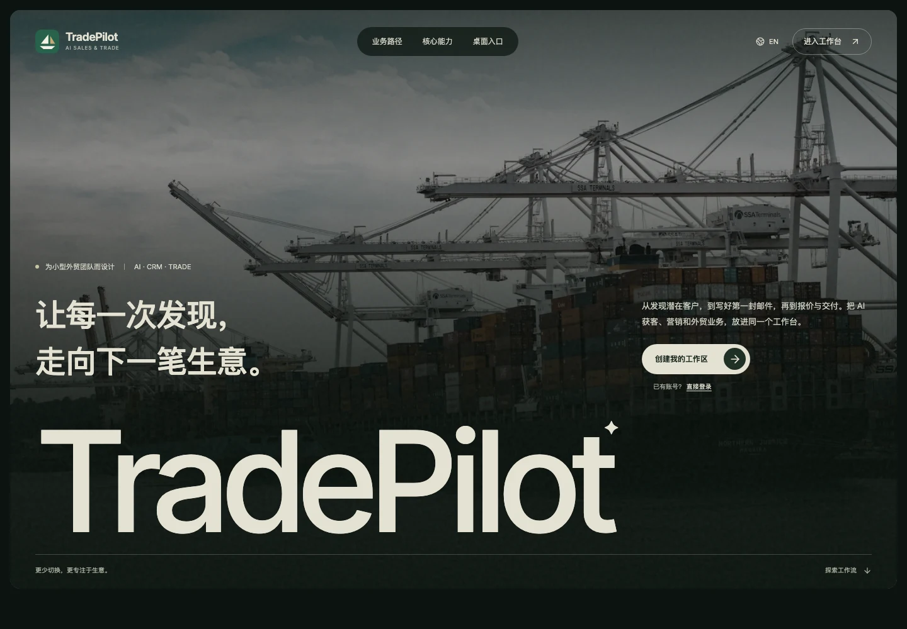
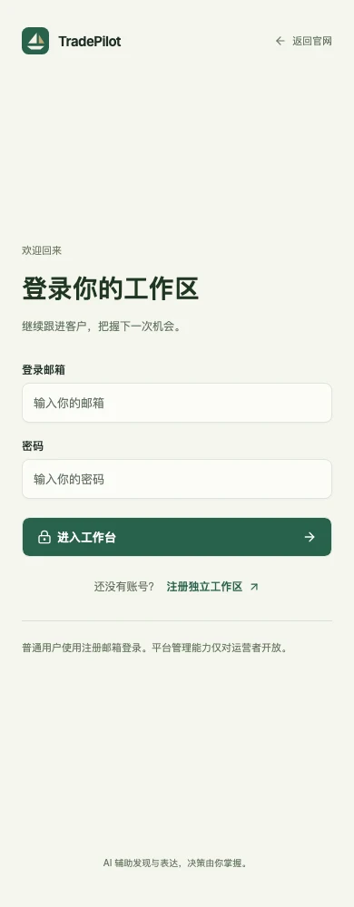
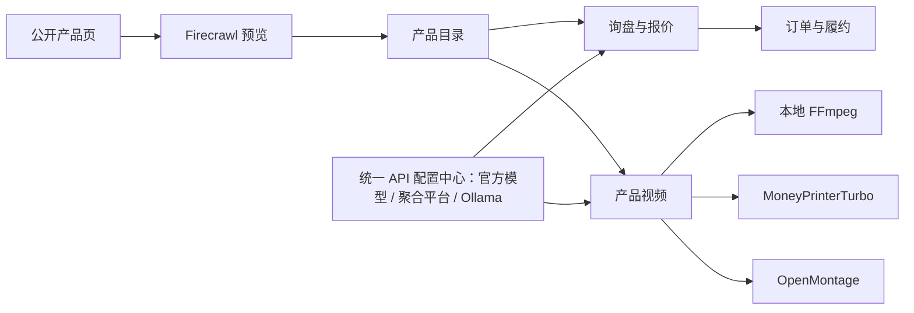

<p align="center">
  <picture>
    <source media="(prefers-color-scheme: dark)" srcset="public/brand/tradepilot-logo-light.svg" />
    
  </picture>
</p>

<h1 align="center">TradePilot</h1>

<p align="center">
  <strong>开源 AI 获客、营销与外贸 CRM 工作台</strong>
</p>

<p align="center">
  AI 获客 · AI 营销 · 微信服务号 · WhatsApp · 客户 · 询盘 · 报价 · 订单 · 产品视频
</p>

<p align="center">
  <a href="https://tradepilot.us.kg/"><strong>在线演示</strong></a>
  ·
  <a href="#快速部署"><strong>快速部署</strong></a>
  ·
  <a href="#微信服务号与-whatsapp-消息"><strong>消息接入</strong></a>
  ·
  <a href="#产品视频工作流"><strong>视频工作流</strong></a>
  ·
  <a href="https://github.com/feifei9126/tradepilot/issues"><strong>反馈问题</strong></a>
</p>

<p align="center">
  
  
  
  
  
</p>

---

> **当前状态（2026-10-14）：可进行本地与受控私有部署，公网 SaaS 上线仍为 NO-GO。** 核心 CRM、AI 获客、工作区与客户权限已使用租户隔离的 PostgreSQL；注册、消息渠道与品牌 UI 的源码和本地 Docker 验证已完成。微信／WhatsApp 的真实收发还需平台凭据、账号权限和可访问的 HTTPS 回调；支付、邮件、AI／语音／视频供应商联调、依赖安全门禁及生产运维验收仍需完成。自助注册默认关闭，可显式开启受控试用。详细记录见 [SaaS 上线审计](docs/saas-launch-audit-2026-09-29.md)。

## 先看效果



<details>
  <summary>查看手机登录界面</summary>
  <p align="center"></p>
</details>

截图来自当前本地 Docker 版本；官网、登录／注册和后台已统一使用「领航帆」品牌，支持桌面、平板和手机布局。

> 仓库中的在线演示链接不保证与当前代码同步。新部署使用自己配置的管理员账号，**不要将本地试用密码用于公网环境**。
>
> **部署状态说明：** Docker + PostgreSQL 是当前完整试用路径；Cloudflare Workers 支持 PostgreSQL 登录与数据库管理员存储（`TRADEPILOT_ADMIN_STORE=postgres`），API 配置和视频素材仍有本地存储依赖，不能作为等价部署。详见 [Cloudflare 部署与限制](docs/cloudflare-deployment.md)。

TradePilot 面向小型外贸团队，把公开网页获客、营销草稿、客户沟通、报价、订单与交付放进同一个可自托管工作区。各家公司使用独立数据空间，团队成员按角色和客户权限协作；账号、AI 服务、邮件和消息渠道都有配置入口与使用说明。

## 本轮更新

- **2026-10-22 登录与数据库：** 修复 Auth.js 认证路由重复 CSRF Cookie，增加 PostgreSQL 部署管理员模式，持久化首次改密、个人资料与会话撤销；保留现有数据库账号与密码，连接凭据只保存为 Cloudflare Secret。
- **2026-10-22 Cloudflare 修复：** 对齐 Next.js 与 OpenNext 版本，修复动态页面清单加载和登录代理异步模块异常；CI 增加实际 Workerd 请求测试。发布沿用 GitHub → Cloudflare 自动同步，配置与验收步骤见 [Cloudflare 部署说明](docs/cloudflare-deployment.md#2026-10-221101-与登录代理异常修复)。

- **统一界面与 Logo**：深绿／米白／黄铜配色，官网、认证页、后台与手机导航保持一致；提供 SVG、透明 PNG、单色和深色版本、浏览器及手机主屏幕图标。
- **账号与注册**：移除共享演示登录；普通用户通过注册建立独立工作区，团队成员由工作区管理员添加。个人中心支持改密和个人偏好，SaaS 管理只向平台运营账号开放。
- **AI 获客与营销说明**：在页面内提供可展开的新手指南，清楚区分 Firecrawl 搜索服务与文本 AI Key、预算和使用步骤。
- **微信／WhatsApp 官方消息渠道**：新增租户配置、签名和加密回调、统一收件箱、来源客户自动建档、文字回复、去重与发送状态。真实账号尚需各自完成联调。
- **数据库管理**：新增消息渠道前向迁移，渠道凭据加密保存，事件去重和发送幂等状态持久化；核心业务不可用时明确报错。

Logo 素材和使用规范见 [品牌资源](public/brand/README.md)，接入与配置文档见下方各功能说明。

## 为什么是 TradePilot

| 你需要解决的问题           | TradePilot 的处理方式                                             |
| -------------------------- | ----------------------------------------------------------------- |
| 客户、询盘、报价和订单分散 | 用一条业务链关联客户、报价、订单、出货和单证草稿                  |
| AI 平台被单一供应商锁定    | 独立 API 配置中心，支持 12 个官方、聚合和本地接入选项      |
| 产品网页和素材整理耗时     | Firecrawl 抓取产品资料、图片和视频，确认后再导入                  |
| 产品视频制作链路割裂       | 本地 FFmpeg、MoneyPrinterTurbo、OpenMontage 三种生产路径统一管理  |
| SaaS 数据与二次开发受限    | AGPL-3.0 开源，支持 Docker 自托管和源码级扩展                     |
| 设置项容易配置失败         | 页面内的新手指南、任务模型覆盖和连接测试 |
| 客户沟通渠道分散           | 微信服务号、WhatsApp 和邮件配置入口，按客户与渠道查看消息 |
| 手机处理业务需要额外软件   | 浏览器登录同一个后台，复用账号、权限和数据库 |

## 核心能力

### 外贸 CRM 与订单履约

- 客户档案、联系人、标签、来源与跟进状态
- 询盘创建、状态流转和 AI 回复草稿
- 报价草稿、贸易术语、成本加价与人工接受确认
- 报价转订单、订单进度、沟通记录和交期风险
- 出货、物流、供应商、财务汇总与单证草稿
- 基于真实业务记录生成的仪表盘、销售漏斗和待办提醒

### AI 获客与 AI 营销

| 功能 | 页面 | 使用方式 |
| --- | --- | --- |
| AI 获客 | `/app/prospecting` | 配置租户 Firecrawl Cloud Key 与日预算，建立业务人设和关键词任务，搜索公开网页、自动登记与规则初筛 |
| AI 营销 | `/app/leads` | 选择业务目标与内容形式，准备活动信息，通过租户文本 AI 生成可编辑营销草稿 |

搜索结果保留来源与摘要，可纠正评分、转入客户库；评分不代表企业真实性或采购意愿验证。营销内容和联系话术不会自动发布或群发。两项功能都附有页面内的使用与配置说明。

详细步骤：[AI 获客](docs/prospecting.md) · [AI 营销](docs/ai-marketing.md)。

### 微信服务号与 WhatsApp 消息

在 **消息渠道**（`/app/bind`）添加账号，在 **消息**（`/app/messages`）查看与回复。工作区所有者／管理员管理渠道配置，成员只能访问自己有权限的客户消息。

| 渠道 | 已实现的接入代码 | 真实接入需要 |
| --- | --- | --- |
| 微信服务号 | 服务器验证、安全模式 AES 解密、文字消息及关注事件接收、客服文字回复 | AppID、AppSecret、Token、EncodingAESKey、接口权限、服务器出口 IP 白名单和 HTTPS 回调 |
| WhatsApp Business Cloud API | Webhook 验证、原始请求 HMAC、消息接收、文字发送及送达／已读／失败回执 | Meta 应用、Cloud API 号码、App Secret、Access Token、Phone Number ID 与 Webhook 订阅 |

- 收到消息后自动建立来源客户、入库并区分渠道会话，重复回调不会重复创建消息。
- 回复通过官方 API 发送；平台接受、送达、已读、失败和结果待核实分别显示。旧内部沟通记录仍只保存记录。
- 微信只接收发给服务号的消息，不读取个人微信聊天。当前文字回复按微信 48 小时、WhatsApp 24 小时客户服务窗口限制；平台权限与频率限制还需实际验证。
- AI 生成回复草稿，由用户确认发送。媒体目前显示类型及说明，尚未实现附件下载／播放、模板群发或微信菜单编辑。
- `localhost` 无法用于官方公网回调。正式部署设置 `AUTH_URL` 为可访问的 HTTPS 域名，然后复制渠道页面生成的参数到微信／Meta 后台。

完整说明：[微信服务号与 WhatsApp 接入](docs/messaging-channels.md)。

### 手机浏览器使用

使用手机浏览器打开已部署的站点并登录，可管理客户、查看消息、生成草稿与回复，无需安装单独的 TradePilot App。提供主屏幕图标和可选的添加主屏幕说明；本地默认监听 `127.0.0.1`，手机访问需要另外配置可访问的站点地址。

当前没有实现关闭网页或锁屏后的消息推送，也不承诺离线处理业务。

### 多工作区、团队与个人中心

- **普通用户**：受控环境开启自助注册后，新邮箱注册建立独立工作区；没有内置共享试用账号。
- **工作区所有者／管理员**：管理本公司成员、AI Key 和预算、邮箱及消息渠道；普通成员使用业务功能，受客户可见范围限制。
- **平台管理员**：单独进入 SaaS 管理与数据库管理，管理工作区和实例服务；普通工作区账号无法访问平台页面或接口。
- **个人中心**（`/app/account`）：修改密码、个人资料与偏好。成员临时密码首次登录必须修改，改密／停用／角色变化会撤销旧会话。

自助注册默认关闭：`TRADEPILOT_SELF_REGISTRATION=false`。受控试用显式设为 `true` 才开放注册；团队成员使用管理员添加流程，当前没有邮件邀请链接、邮箱验证或 MFA。

详细说明：[SaaS 多工作区与团队权限](docs/saas-multi-user.md) · [数据库配置与管理](docs/database-management.md)。

### 独立 API 配置中心

**平台管理员**登录后从 **系统 → API 配置中心**（`/app/api-config`）管理实例服务，不在“设置”页面分散填写。以下四步与提供商选项描述平台入口；普通工作区的文本 Key、模型和预算在 **AI 用量**（`/app/ai-usage`）配置，Firecrawl Cloud Key 在 **AI 获客 → 获客服务配置** 配置。工作区配置需所有者/管理员操作，普通成员不能借用平台共享 Key。

1. **接入文本模型**：选择平台，填写 API Key、模型 ID 和接口地址。
2. **分配 AI 功能**：询盘、邮件、文字客服、客户资料识别、产品资料补全、报价、跟单、获客文案和视频脚本共用默认 API，也可逐项覆盖模型。
3. **连接语音与视频**：集中管理 LiveKit / OpenAI Realtime、视频适配器、MoneyPrinterTurbo；此处的 Firecrawl 仅用于实例诊断，不作为工作区业务抓取的凭据回退。
4. **验证并开始使用**：先保存，再测试连接；模型调用可能产生费用。

| 分类 | 接入选项 |
| --- | --- |
| 官方平台 | OpenAI（ChatGPT）、Kimi（Moonshot）、豆包（火山方舟）、Google Gemini、智谱 GLM、DeepSeek、通义千问 |
| 第三方聚合 | OpenRouter、硅基流动（SiliconFlow）、New API / One API 网关 |
| 本地及自定义 | Ollama、其他 OpenAI 兼容 API |

- 预设提供接口地址、模型 ID 填写提示和文档入口。新平台模型以账号控制台实际可用 ID 为准。
- 聚合平台可按业务功能选择不同厂商模型，仍共用聚合平台自身的地址和 Key。
- **Docker / Node 密钥存于服务端 AES-256-GCM 加密文件，不回显给浏览器。** 仅部署管理员可管理；当前是单实例配置，不是多租户密钥保险库。
- 切换平台清空旧密钥、请求头与任务模型，避免将旧凭据发给新服务。旧浏览器配置仅在明确选择后迁移。
- 文本接口采用 OpenAI Chat Completions 协议；不是所有图像、视频或实时语音模型都能通过这一接口调用。

详见 [统一 API 配置指南](docs/api-configuration.md)。

### LiveKit AI 语音客服与营销

登录后进入 **AI 语音客服**（`/app/voice-agent`）：

- 客服答疑 / 营销意向两种场景，中英文实时语音与字幕。
- 收集客户意向后由操作员确认，再创建 CRM 客户。
- 支持人工跟进请求与本地下载对话记录。
- 独立 Python Agent Worker 使用 LiveKit + OpenAI Realtime，在配置中心保存连接信息后加载。

**统一入口不等于一个 Key 访问所有服务。** 其他文本平台的 Key 不会用于 OpenAI Realtime。当前是内部工作台，不包含公开访客入口、自动电话外呼或真实人工坐席转接。AI 营销生成营销文案；AI 获客可在配置 Firecrawl 后按任务搜索公开网页、自动登记和初筛线索，但不登录社媒、自动投放或群发。

详见 [LiveKit Agents 接入说明](docs/livekit-agents.md)。

### Firecrawl 产品采集

- 从公开产品页提取名称、描述、规格、图片和视频
- 导入前预览与人工确认，不直接污染产品数据
- 抓取到的视频可进入 MoneyPrinterTurbo 重新编排
- 工作区所有者/管理员先在 **AI 获客 → 获客服务配置** 保存自己的 Firecrawl Cloud Key 和日预算；不使用实例 Key 或任意自托管地址
- 产品抓取与获客搜索共用工作区 UTC 日请求预算，失败和未结算请求也计次；这不是供应商的精确费用账单
- 当前产品抓取入口仅对平台管理员开放，普通成员不能通过兼容 API 绕过；弹窗提供配置提示、预览与确认，不再负责安装/部署 Firecrawl
- 独立平台诊断与 CLI 部署能力仍保留，不能把健康检查通过视作真实抓取验收

### 产品视频工作流

| 模式        | 适合场景           | 运行方式                                       |
| ----------- | ------------------ | ---------------------------------------------- |
| 本地快速    | 内部确认、快速样片 | FFmpeg Worker 生成可播放 MP4                   |
| AI 自动成片 | 社媒推广、客户介绍 | MoneyPrinterTurbo 处理配音、字幕、音乐和多素材 |
| 高级制作    | 品牌项目、复杂镜头 | OpenMontage 命令适配器接入自定义流水线         |

产品视频页包含引擎健康状态、素材输入、任务队列、进度、预览、下载、批量选择和删除。可勾选使用统一 AI 模型生成脚本，再交给渲染服务。视频任务元数据按工作区保存到 PostgreSQL，渲染文件保存到 Worker 卷或外部对象存储；两者需分别备份，数据库恢复不会还原 MP4 文件。

## 快速部署

### Docker 一键部署

前置条件：Docker Desktop，或已启用 Compose 插件的 Docker Engine。

Apple Silicon（M1/M2/M3）使用原生 Linux ARM64 Docker 镜像。Web 以 Node.js 运行，构建与启动均不初始化 Cloudflare Workerd；无需 macOS 二进制或 AMD64 模拟。排错步骤见 [Docker 本地试用](docs/docker-trial.md#apple-siliconm1--m2--m3--arm64)。

```bash
git clone https://github.com/feifei9126/tradepilot.git
cd tradepilot
bash install.sh
```

安装器会：

1. 补充缺失的认证密钥、管理员密码和随机 PostgreSQL 密码，不覆盖已有账号配置。
2. 启动 PostgreSQL，执行前向迁移与首次账号初始化，再启动 TradePilot 和本地视频 Worker。
3. 在后台启动 MoneyPrinterTurbo 和 Redis。
4. 输出首次初始化账号、密码和状态命令；已有账号以个人中心修改后的密码为准，数据库密码不打印。

默认访问 [http://localhost:3461](http://localhost:3461)，以安装器实际输出为准。

常用命令：

```bash
docker compose ps
docker compose logs -f
docker compose restart
docker compose down
```

### 最小 Docker 试用（推荐先从这里开始）

启动 Web、内置 PostgreSQL、一次性迁移与视频适配器，不自动拉取 MoneyPrinterTurbo / Redis，也不调用付费模型：

```bash
cp .env.example .env # 仅首次且 .env 不存在时执行；已有配置不要覆盖
chmod 600 .env
# 编辑 .env：填写随机 AUTH_SECRET、POSTGRES_PASSWORD、强管理员密码
# 默认 AUTH_URL=http://localhost:3461；随机值可用 openssl rand -hex 32 生成。
# 不要覆盖已有部署的加密密钥；修改端口时同时修改 PORT 和 AUTH_URL。
docker compose up -d --build tradepilot video-worker
```

使用 `.env` 中的管理员账号登录，然后进入 API 配置中心。语音 Worker 按需启动：

```bash
docker compose --profile voice up -d --build livekit-agent
```

**使用期间保持 Docker Desktop 运行。** 默认仅监听本机 `127.0.0.1:3461`，其他电脑不能直接访问。若页面打不开，先检查 Docker，再执行 `docker compose ps`；已创建的试用容器可先启动 `postgres`，再启动 `tradepilot video-worker`；有版本变化时使用 `up` 重新执行迁移。不要执行 `docker compose down -v`，以免删除数据卷。

本地受控试用可在私有 `.env` 设置 `TRADEPILOT_SELF_REGISTRATION=true` 开放「创建工作区」入口；每个新邮箱会创建独立工作区，团队成员由工作区管理员添加。默认关闭，不能据此认定公网注册已通过上线安全验收。

完整说明：[Docker 本地试用](docs/docker-trial.md)。

### 本地开发

> 当前 NextAuth 版本把 Nodemailer 声明为可选 peer（范围仅到 8.x），而 TradePilot 的租户 SMTP 使用 Nodemailer 10。项目不使用 NextAuth Email Provider，因此安装命令需带 `--legacy-peer-deps`；此参数会跳过 npm 的 peer 依赖校验，依赖升级后应复查并在上游兼容后移除。

```bash
git clone https://github.com/feifei9126/tradepilot.git
cd tradepilot
npm ci --legacy-peer-deps
# 准备 PostgreSQL，配置 .env.local 的 PG*、AUTH_SECRET 和管理员账号
# 详细步骤见 docs/database-management.md
npm run db:init
npm run dev
```

开发地址为 [http://localhost:3458](http://localhost:3458)。数据库是必需项，不可用时业务返回 503，不会回退共享内存。开发/生产均不内置公开演示账号；请配置自己的管理员凭据。

生产运行：

```bash
npm run build
npm start
```

`npm start` 会同时管理 Next.js 和本地视频 Worker；无需再开第二个终端。只启动网页可设置 `TRADEPILOT_START_VIDEO_WORKER=false`。

### Cloudflare Workers（构建预览，非 Docker 等价部署）

GitHub 用于托管源码；本项目有登录、服务端 API 和独立 Worker，**不能直接部署为 GitHub Pages 静态站点**。

仓库使用 OpenNext + Wrangler 生成 Cloudflare Worker：

```bash
npm ci --legacy-peer-deps
npm run cfbuild
npx wrangler deploy --dry-run
```

**构建通过不代表功能可上线。** 当前仍有以下必须处理的限制：

- 部署管理员与 API 配置仍使用本地文件；Workers 没有等价持久磁盘，不能用 `/tmp` 代替。
- CRM、获客和视频任务元数据已迁移 PostgreSQL，但连接池、事务锁、迁移启动与 TLS 仍须在 Workers 运行时独立验收；不能拿 Docker 测试结果替代。
- Python LiveKit Agent、FFmpeg、MoneyPrinterTurbo 和抓取引擎需要独立服务，不会随 Web Worker 一起部署。
- `DATABASE_URL` 不会自动迁移旧版 JSON 文件、媒体或解密主密钥，也不会让外部 Worker 自动上线。

在接入持久化存储、配置线上强凭据并完成运行时验收前，不建议覆盖既有线上站点。Cloudflare 登录、Secrets、隔离预览、验收和回滚步骤见 [Cloudflare 部署说明](docs/cloudflare-deployment.md)。

## 工作流



## 配置

仅首次部署且 `.env` 尚不存在时，复制环境变量模板；已有配置应逐项补充：

```bash
cp .env.example .env
```

关键配置：

| 变量                        | 用途                                        |
| --------------------------- | ------------------------------------------- |
| `AUTH_SECRET`               | NextAuth 会话签名密钥，生产环境必须随机生成 |
| `AUTH_URL`                  | 站点地址；官方消息回调与正式部署使用可访问的 HTTPS 域名 |
| `TRADEPILOT_SELF_REGISTRATION` | 是否开放独立工作区注册，默认 `false`；受控试用可显式开启 |
| `TRADEPILOT_ADMIN_EMAIL`    | 部署管理员邮箱                              |
| `TRADEPILOT_ADMIN_PASSWORD` | 生产初始密码至少 16 位、两类字符；已保存哈希优先，不被环境变量重置 |
| `DATABASE_URL`              | 外部 PostgreSQL 连接；Docker 也可使用离散 `PG*` 变量（业务数据库必需） |
| `METRICS_TOKEN`              | 可选，启用 Bearer Token 保护的 Prometheus `/api/metrics` 端点 |
| `TRADEPILOT_DATA_DIR`       | 实例加密配置、管理员账号文件和部分持久化媒体目录（Docker / Node）                      |
| `OPENMONTAGE_WORKER_URL`    | OpenMontage / 本地 FFmpeg Worker 地址       |
| `MONEYPRINTERTURBO_URL`     | MoneyPrinterTurbo API 地址                  |
| `FIRECRAWL_API_URL`         | 平台实例 Firecrawl 诊断地址；不作为租户搜索/产品抓取回退 |
| `FIRECRAWL_API_KEY`         | 平台实例 Firecrawl 诊断 Key；业务使用工作区加密 Cloud Key |
| `TRADEPILOT_CONFIG_KEY`     | 可选独立配置加密密钥；未设置时使用 `AUTH_SECRET`，至少 32 字符 |
| `LIVEKIT_URL` / `LIVEKIT_API_KEY` / `LIVEKIT_API_SECRET` | LiveKit 连接参数 |
| `OPENAI_API_KEY`            | 可选 OpenAI Realtime 环境回退凭据，不自动作为统一文本 Key |

## 数据与功能边界

不同数据和服务的存储、接入要求如下：

- 当前 CRM 与获客等核心业务数据以 PostgreSQL 为持久化存储；数据库不可用时业务请求失败，不回退到共享内存样例数据。管理员配置、媒体文件和浏览器草稿仍分别位于配置卷、Worker/对象存储和浏览器本地，须按[数据库管理指南](docs/database-management.md)分别备份。
- 工作区和团队权限已有数据库与服务端隔离基础，但这不等于全部 API 均已完成生产级客户对象权限审计；公网 SaaS 当前仍为 NO-GO。
- 邮件已有租户 SMTP／IMAP、退订抑制与确认流程的接入代码和安全验证；真实邮箱收发、投递质量和运营流程仍需供应商验收。
- 微信／WhatsApp 账号密钥加密保存在 PostgreSQL，事件去重与发送状态也在数据库中。媒体只记录类型和说明；公众号和 Meta 的真实平台收发尚需验收。
- 单证为可下载的业务草稿，对外使用前必须核对卖方、包装、支付和合规字段。
- 插件通过源码目录与脚本管理，不在生产环境执行未经审查的第三方运行时代码。
- AI 输出、抓取内容和视频脚本都应由业务人员确认后使用。
- 密钥、数据库 URL、真实客户资料、加密配置文件和数据卷都不能提交到 GitHub；更换加密密钥前须备份原密钥与配置文件。
- 真实模型、实时语音、抓取与完整视频渲染需要对应账号权限和独立服务；本地 mock 测试不等于真实厂商联调。
- 仓库含 CI 依赖审计与 Dependabot 配置，但每次安全告警仍须人工分级修复；公网部署前必须使用 HTTPS、独立强凭据和 Secret Manager，不能照搬公开试用账号。

## 技术栈

| 层级      | 技术                                           |
| --------- | ---------------------------------------------- |
| Web       | Next.js 16、React 19、TypeScript、Tailwind CSS |
| UI        | Base UI、Lucide、Motion                        |
| Auth / DB | NextAuth、Drizzle ORM、pg、PostgreSQL 16（支持外部 PostgreSQL） |
| AI        | 统一配置、OpenAI 兼容请求层、Ollama                      |
| 语音      | LiveKit Agents、OpenAI Realtime、Python / uv |
| 采集      | Firecrawl                                      |
| 视频      | FFmpeg、MoneyPrinterTurbo、OpenMontage Adapter |
| 部署      | Docker Compose、OpenNext、Cloudflare Workers   |
| 测试      | Node Test Runner、TSX                          |

## 项目结构

```text
tradepilot/
├── src/app/                 # 页面与 API 路由
├── src/components/          # 业务组件与 UI 基础组件
├── src/lib/                 # AI、业务、采集、视频与安全逻辑
├── tests/                   # 业务、配置安全、LiveKit、视频与构建测试
├── agents/customer-service/ # 独立 Python LiveKit Agent Worker
├── workers/openmontage-adapter/
├── public/brand/            # SVG / PNG Logo 与使用规范
├── scripts/database/migrations/ # 不可变前向 SQL 迁移
├── docs/                    # 集成、设计与部署说明
├── docker-compose.yml
├── install.sh
└── wrangler.jsonc
```

深入文档：

- [统一 API 配置与 12 个提供商接入](docs/api-configuration.md)
- [Docker 本地试用与恢复](docs/docker-trial.md)
- [SaaS 多工作区 / 团队权限（初学者）](docs/saas-multi-user.md)
- [数据库配置 / 迁移 / 备份恢复（初学者）](docs/database-management.md)
- [微信服务号与 WhatsApp 消息接入](docs/messaging-channels.md)
- [Logo 素材与品牌使用规范](public/brand/README.md)
- [当前界面设计说明](docs/design/ui-direction-2026-10-13.md)
- [SaaS 上线审计与整改证据](docs/saas-launch-audit-2026-09-29.md)
- [生产运维、监控与发布门禁](docs/production-operations.md)
- [AI 获客使用说明](docs/prospecting.md)
- [AI 营销使用说明](docs/ai-marketing.md)
- [LiveKit AI 语音客服](docs/livekit-agents.md)
- [Cloudflare 部署限制与验收](docs/cloudflare-deployment.md)
- [Firecrawl 产品媒体采集](docs/firecrawl-product-media.md)
- [MoneyPrinterTurbo 产品视频](docs/moneyprinterturbo-product-video.md)
- [OpenMontage 产品视频](docs/openmontage-product-video.md)
- [架构说明](ARCHITECTURE.md)
- [贡献指南](CONTRIBUTING.md)
- [安全策略](SECURITY.md)

## 验证

```bash
npm test
npx tsc --noEmit
npm run lint
npm run build
# 必须显式指定独立的 loopback 测试库（库名以 _test 结尾，不能用生产库）
TEST_DATABASE_URL=独立测试库连接串 npm run test:db
# 如使用 LiveKit Worker（需安装 uv）
uv run --directory agents/customer-service pytest -q
uv run --directory agents/customer-service ruff check .
# Cloudflare 构建检查，不会上传
npm run cfbuild
npx wrangler deploy --dry-run
```

本次源码验证（2026-10-14）：

| 检查 | 结果 |
| --- | --- |
| ESLint / TypeScript | 通过 |
| 单元与业务测试 | 146 / 146 通过 |
| 独立 PostgreSQL 集成测试 | 52 / 52 通过 |
| Next.js 生产构建 | 通过 |
| 全量 npm 依赖审计 | 12 High、4 Moderate；现有 CI 安全门禁未通过，未降低阈值 |

单元测试覆盖业务流程、输入限制、账号会话与注册、服务配置、消息签名／加密／发送状态、请求安全与媒体地址。独立 PostgreSQL 集成测试覆盖双租户 CRUD/导入导出隔离、复合外键、权限、并发名额、会话撤销、迁移/初始化重跑、消息去重与发送幂等、凭据轮换及数据库故障拒绝。内部路由测试不替代真实 HTTP 登录、付费厂商联调、HTTPS/安全审计、压测或灾备制度；不得以构建成功宣称生产验收完成。

## 适用场景

TradePilot 适合寻找以下方案的开发者和小型团队：开源外贸 CRM、外贸订单管理系统、跨境贸易管理、自托管 CRM、私有化 AI 跟单、Ollama 外贸应用、Firecrawl 商品采集，以及产品视频自动生成工作流。

## 参与项目

- 使用问题与功能建议：[GitHub Issues](https://github.com/feifei9126/tradepilot/issues)
- 提交代码前阅读：[CONTRIBUTING.md](CONTRIBUTING.md)
- 安全问题请按：[SECURITY.md](SECURITY.md)

如果这个项目解决了你的实际问题，可以在 GitHub 点 Star，帮助更多需要开源外贸管理工具的团队发现它。

## License

TradePilot 使用 [GNU AGPL-3.0](LICENSE) 许可证。通过网络提供修改后的版本时，请遵守 AGPL-3.0 的源代码开放要求。
